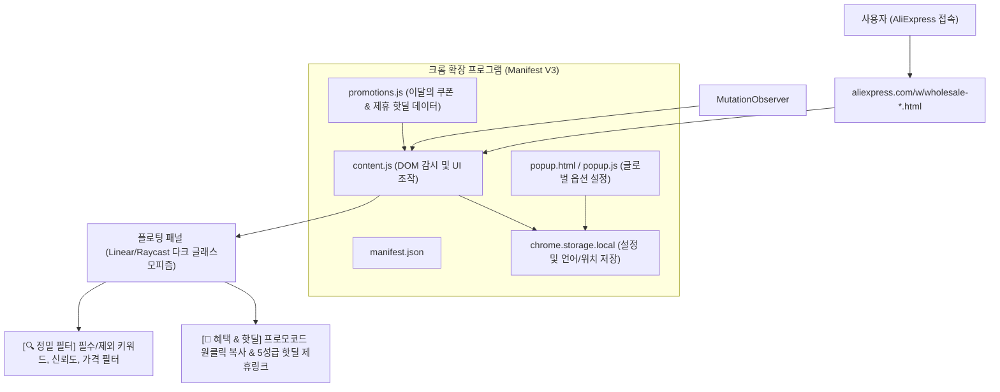

# 시스템 맵 (SYSTEM_MAP.md)

## 1. 프로젝트 개요
- **프로젝트명**: AliExpress Strict Keyword Filter & Highlighter (AliFilter)
- **목적**: 알리익스프레스 검색 시 불필요한 연관 상품 및 키워드 누락 상품을 걸러내고, 필수 키워드 하이라이트 및 이달의 공식 프로모션 코드 & 5성급 검증 핫딜(제휴 트래킹 연동) 제공
- **실행 환경**: Google Chrome Extension (Manifest V3)

## 2. 아키텍처 및 모듈 구성

## 3. 기술 스택
- **Extension Spec**: Chrome Manifest V3
- **Languages**: Vanilla JavaScript (ES6+), HTML5, CSS3 (외부 프레임워크 없는 초경량 아키텍처)
- **DOM Engine**: `MutationObserver` (무한 스크롤 및 지연 로딩 DOM 실시간 감지)
- **Storage**: `chrome.storage.local` (하이라이트 색상, 필터 모드, 언어, 패널 위치 저장)
- **Affiliate & Monetization**: AliExpress Portals (트래킹 ID: `alifilter`, 구글 웹스토어 & 알리 정책 100% 준수)
